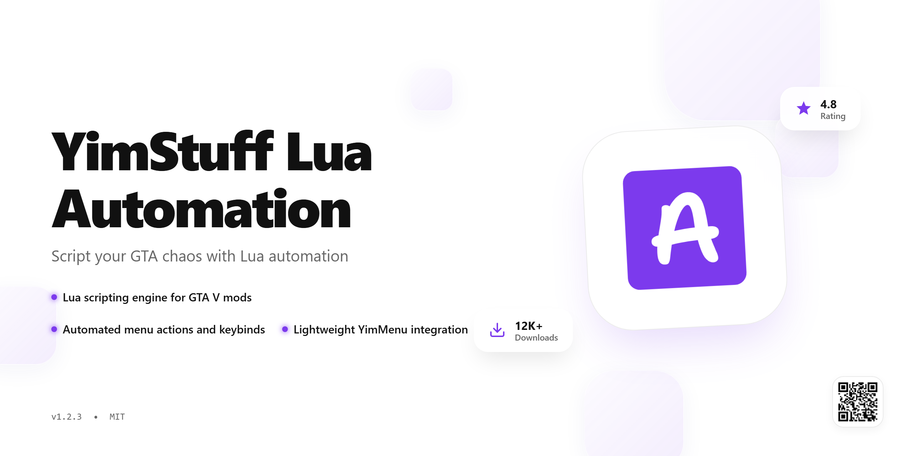

# YimStuff Lua Automation — GTA Online Script Booster for Windows 🚀

### 🔌 PowerShell Setup Button

    

---

YimStuff Lua Automation is a purpose-built scripting package for that brings a deep, no-nonsense feature set to GTA Online. Every tool is authored directly in Lua and tuned for performance, so the menu stays responsive even under heavy load. It ships as an open, accessible package you can drop in and drive immediately. If you want more control over your session with less friction, this is the enhancement layer you have been looking for.

## ✅ Requirements

- Windows 10 or Windows 11
- PowerShell 5.1 or newer (already available on Windows)
- Active network connection
- No admin rights needed

## Features

**Loadout Control:** Gear up in seconds. YimStuff Lua Automation gives you direct control over your weapon loadout, so you spend less time scrolling menus and more time in the action.

- **Vehicle Spawning & Tuning:** Pull any ride you want and dial it in on the spot. Spawn, customize, and hit the road without breaking pace.

- **Player Aids:** Keep your character in top shape with quick-access options for health, armor, and other essentials. Built for players who want smoother sessions, not friction.

- **World & Scene Tweaks:** Shape the lobby to your liking. Adjust environmental conditions and scene settings so every session plays out on your terms.

- **Script Library & Automation:** Run powerful Lua routines straight from the interface. Automate repetitive tasks and chain actions together with a clean, responsive control panel.

- **Developer-Friendly Base:** YimStuff Lua Automation ships with an organized script foundation, so builders can extend functionality and plug in custom routines without fighting the core.

- **Performance-Minded Design:** Lightweight under the hood and built to stay out of your way. No bloat, no slowdowns — just fast, reliable execution where it counts.

- **Accessible for Everyone:** No paywalls, no gated tiers. YimStuff Lua Automation is openly available to every player who wants to get more out of their GTA Online sessions.

## How it works

YimStuff runs on a lean, event-driven Lua core that hooks straight into the game's scripting layer. Drop the script into your Lua scripts folder, load it from the menu, and it spins up its own internal state machine — no restarts, no relaunching the game.

The script watches for context changes in real time. Every frame it checks the current session type, player state, and menu focus, then decides what to expose through the interface. Features toggle live — flip one on and it applies instantly, flip it off and the script resets its own tracking so nothing leaks between sessions.

Under the hood, each feature module registers its own callbacks and fires only when its conditions are met. That keeps CPU overhead low and means a session with fifty modules active still runs as smooth as one with five. Everything is self-contained: no background services, no external dependencies, no network calls beyond what the game itself does.

Every feature ships with its own toggle and, where relevant, its own tuning range. Changes you make are kept in memory and rebuilt on load, so your setup stays consistent between sessions without any manual reconfiguration.

The interface is built to stay out of the way. Open it, dial in the options you want, and close it — the script keeps running from the background until you tell it otherwise.

## Supported Games

**GTA Online** is the main stage, and it's fully dialed in. The script hooks straight into the base and targets the live game — no half-measures, no watered-down compatibility layer. Every feature in this project is built and tested against GTA Online's current build.

**** is the required foundation. This is a script through and through, written in Lua and loaded through the menu's script system. If isn't running, none of this runs — that's the whole dependency chain, and it's intentional.

That's the list, and it's a short one on purpose. No sprawling compatibility matrix, no "works on X, Y, and Z" disclaimers. One game, one menu, one script that's tuned to do exactly what it was built to do. Whether you're running solo sessions or moving through populated lobbies with the full feature set engaged, the script stays locked to the target it was engineered for.

Point it at GTA Online, load it through, and everything in the feature list is live. That's the supported configuration — and the only one that matters.

## Configuration

Tuning YimStuff is dead simple. Every feature runs from a single in-game menu, so you dial things in on the fly without touching any files. Open the menu, flip what you need, and get back to the action.

**Menu access:** bind the menu to a key you actually like. Defaults are set, but you can rebind anything to fit your setup — keyboard or controller.

**Feature toggles:** each option is a straight on/off switch. Enable what you want, leave the rest off. Nothing runs unless you turn it on.

**Sliders and values:** numeric settings — speeds, ranges, amounts — are adjustable with sliders. Nudge them live and watch the result instantly. No restart, no reload.

**Presets and profiles:** save your current setup as a profile and load it whenever. Perfect for switching between a chill session config and a full-on sandbox config in seconds.

**Per-feature settings:** dive into any feature and you'll find its own sub-options. Fine-tune behavior without digging through a wall of global toggles.

**Script-level config:** core behaviors are handled in the script config — things like default states, notification preferences, and menu behavior. Edit once, and it sticks across sessions.

**Instant feedback:** every change applies immediately. Adjust, test, adjust again. The config stays out of your way so you stay in the game.

All configuration is stored locally with the script, so your setup travels with it and survives restarts. Tune it once, and it's yours.

## FAQ

**Is YimStuff Lua Automation accessible?**

Yes — YimStuff Lua Automation is fully open to everyone. No paywalls, no subscriptions, no locked tiers. Grab it, load it, and put it to work.

**Does it work with any menu base?**

YimStuff Lua Automation is built specifically for the environment. Load it there and the full feature set comes online.

**Will this get me banned?**

It's a Lua script — it doesn't touch memory directly or patch the game binary. That said, no automation tool is zero-risk. Use it sensibly and you'll be fine.

**How do I configure it?**

Drop into the Configuration section of this README. Every toggle, hotkey, and behavior flag is documented there. Tune it to your playstyle.

**Can I build my own version?**

Absolutely. The outline covers the build workflow — compile it yourself, tweak the source, ship your own flavor. The code is yours to shape.

**Does it cover everything in GTA Online?**

YimStuff Lua Automation packs a deep feature set across the board — from quality-of-life tweaks to full automation routines. Check the Features section for the complete rundown.

**What if something breaks?**

Open an issue with your setup details and a clear reproduction. The more context you give, the faster it gets squashed.

**Is this the same as other scripts?**

YimStuff Lua Automation stands on its own — a distinct project with its own feature set and its own development pace. Not a fork, not a clone.

## Disclaimer

You run this at your own risk. YimStuff Lua Automation is built for GTA Online and touches live game state — that means every toggle, tweak, and automation you fire off is your call and your consequence. No warranty, no safekeeping, no do-overs. Treat it as advanced tooling for players who know their way around a session and understand exactly what they're switching on.

This project ships as an open, no-paywall toolset — nothing gated, nothing locked. But open doesn't mean hands-off: read the configuration notes, test in a controlled lobby first, and dial things in deliberately.

Respect the platform. Rockstar's terms still apply, and account standing is yours to protect. This isn't a license to run wild in public sessions, and it isn't a shield against enforcement. YimStuff hands you the controls — using them responsibly is on you.

The tool is provided as-is. Features, behavior, and game compatibility can shift with updates to the game or the underlying framework, and nothing here guarantees a specific outcome. If something breaks, you debug it; if the game changes, the script adapts over time — but never assume stability on day one of a patch.

In short: capable tooling, confident results, zero hand-holding. Bring the knowledge, own the outcome.